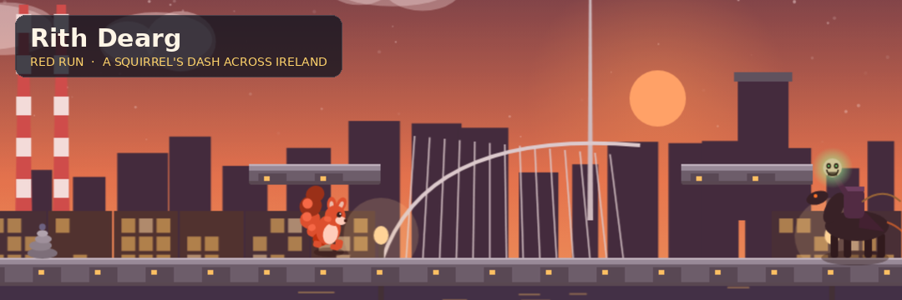

# Rith Dearg (Red Run)

**Play it:** <https://eoinfitzsimons.github.io/Rith-Dearg/>



Rith Dearg is a browser platformer about a red squirrel running the length of Ireland. Twenty-five levels take you from the oak woods of Killarney, over the Cliffs of Moher and the Burren's limestone, through Glendalough's glen and lakes, and finally across the Dublin rooftops where the Dullahan — the headless horseman of Irish folklore — guards the last gate.

It is a single static page: plain HTML, CSS and JavaScript with no framework, no build step and no asset files. Every sprite, backdrop and sound is drawn or synthesised in code at run time.

## How to play

| Action | Keys | Mouse |
| --- | --- | --- |
| Move | `←` / `→` or `A` / `D` | |
| Jump (tap for a hop, hold for a long leap) | `Space`, `W` or `↑` | right or middle click |
| Swim stroke (in water) | tap jump | right or middle click |
| Dive | `S` or `↓` | |
| Tail swipe (attack) | `J` or `K` | left click |
| Pause | `P` or `Esc` | |
| Mute / unmute | `M` | |
| Leaderboard | `L` | |

Mouse clicks only register on the game canvas while a level is being played, so they never interfere with the menus. Power-ups take effect the moment they are picked up, so there is nothing to cycle through. Touch controls appear automatically on phones and tablets.

On phones and tablets a touch pad appears with the same controls. Press **Play** to start, or open **Level Select** to replay any stage you have already reached.

### Rules of the run

- You start with three lives and a health bar. Enemies and spikes drain health; when it hits zero you lose a life and return to the last checkpoint.
- Falling off the bottom of the level costs a life.
- Reach the signpost at the end of a level to clear it. Clearing a level unlocks the next one and saves your best score.
- Tail-swipe foes for points and the occasional power-up drop. Collect acorns for a bonus and finish quickly for a time bonus.
- Acorn trails mark the intended route and arc over every gap; a shield or health restore is placed before each hard section, and checkpoints (cairns) sit just before the tricky parts.
- Look for optional high roads: short detours above the main route that pay out acorn clusters and power-ups.

### Mechanics

- **Water** — you float at the surface and can leap out. Dive and you have six seconds of breath; stay under longer and you take damage until you surface.
- **Wind** — gusts push you sideways, strongest in the air. Lean into them.
- **Moving ledges** — platforms that drift horizontally or vertically carry you with them.
- **Boss** — the Dullahan paces its rooftop arena, charges and throws its head. It is stunned when it hits a wall after a charge; that is your moment to strike. Defeat it to unlock the gate.

### Power-ups

Speed Boost · Shield · Extra Life · Time Freeze · Score Multiplier · Health Restore

### Enemies

Púca (hopping rabbit spirit), raven, cú sídhe (fairy hound), will-o'-the-wisp, stone golem, banshee (floats and dives when you are near), merrow (surfaces from the water to leap at you) and the Dullahan boss.

## Features

- 25 levels: 20 generated stages built from hand-designed layout patterns (runs, gap sequences, staircases, vertical climbs, moving-platform bridges, lifts and optional high roads), each with its own Irish landscape and palette, plus five handcrafted stages — Lough Tay, Burren Winds, Moher Ledges, Glendalough Lakes and Dublin Skyline — introducing water, wind, moving platforms and the boss encounter.
- Every gap is sized against the squirrel's measured jump arc (see `JUMP_REACH` in `js/levels.js`), with a difficulty curve that lengthens gaps, adds hazards and enemies, and introduces new patterns as the levels progress.
- Eleven procedural parallax backdrop families drawn on canvas: forest, sea cliffs, the Giant's Causeway, the Burren, mountains, island, passage tomb, bog, glen with round tower, castle and the Dublin skyline (Poolbeg chimneys, the Spire, Liberty Hall, the Custom House and the Samuel Beckett Bridge).
- A code-drawn squirrel with idle, run, jump, fall, attack and swim animation, plus unlockable coats and accessories.
- Title screen with a live animated backdrop, level-select screen, how-to-play and customise screens.
- Progress, best scores, leaderboard, chosen skin and mute setting are saved in `localStorage`.
- Synthesised chiptune music (a title theme and a play theme) and sound cues for jumping, swimming, landing, attacking, collecting, taking damage, checkpoints and the boss, all generated with the Web Audio API.
- Keyboard, mouse and touch input; the canvas scales to any window.
- Developer level viewer: open the page with `?level=N` (1–25) to jump straight into a level; progress is not saved while testing this way.

## Running locally

Any static file server will do. From the repository root:

```sh
python3 -m http.server 8000
```

then open <http://localhost:8000/>. (Opening `index.html` directly from disk also works in most browsers, but a server matches how GitHub Pages serves it.)

## Technical notes

- **Structure** — `index.html` holds the markup and screens, `css/style.css` the HUD and menus, and the game is split into classic scripts under `js/` loaded in order: `config.js` (constants, storage, RNG), `audio.js` (Web Audio synth), `input.js`, `sprites.js` (all drawing routines), `backdrops.js` (parallax layers), `levels.js` (procedural and handcrafted level data), `entities.js` (player, enemies, boss, power-ups, particles) and `game.js` (loop, screens and glue).
- **Rendering** — a 960×540 virtual canvas scaled to the window. Each backdrop layer is rendered once to an off-screen canvas tile and scrolled at its own parallax rate; sprites are drawn with Canvas 2D paths every frame.
- **Levels** — generated levels chain layout patterns chosen by a seeded pseudo-random generator so a given level always has the same layout; every gap is derived from the measured jump-reach table and checked for reachability. Level data is plain objects (platforms, hazards, water, wind zones, movers, acorns, enemies, checkpoints, power-ups).
- **Physics** — fixed-cap delta time, axis-separated AABB collision, coyote time for forgiving jumps, buoyancy and drag in water, and wind applied as acceleration.
- **Audio** — a single `AudioContext` created after the first user gesture; music is scheduled a few steps ahead with oscillators and a short noise buffer for percussion.
- **Persistence** — `localStorage` keys prefixed `rd_`.

No external libraries, images, fonts or audio files are used.
